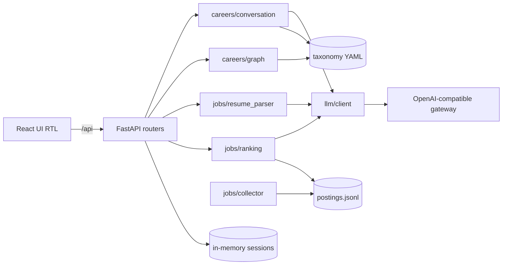

# Architecture



## Contracts (`backend/app/schemas.py` ↔ `frontend/src/types.ts`)

| Contract | Fields |
|---|---|
| `Level` | junior \| mid \| senior |
| `CareerProfile` | target_role, target_level, current_level, known_concepts, heard_of_only |
| `ChatRequest` / `ChatResponse` | session_id, message / reply, profile?, done, questions_asked |
| `Roadmap` | role, level, nodes[`RoadmapNode`], edges[`RoadmapEdge`], order, summary_fa |
| `RoadmapNode` | id, label_fa, label_en, layer, status (todo\|known), resources[`Resource`] |
| `Resource` | title, url, lang, type, verified |
| `CorrectionRequest` | session_id, message |
| `ResumeProfile` | skills, skill_ids, years_experience, education, previous_roles, location, level_guess |
| `JobPosting` | id, source, title, company, location, remote, seniority, requirements, skill_ids, published_at, url |
| `JobMatch` | posting, score, matched_skills, missing_skills, explanation_fa |
| `MatchRequest` | session_id, filters{location?, seniority?, remote?}, method (baseline\|hybrid) |
| `UsageReport` | session_id, prompt_tokens, completion_tokens, est_cost_usd, calls |

## Data flow

**Module A:** chat (≤6 questions) → `chat_json` → `CareerProfile` → ids validated against taxonomy (unknown discarded) → `compute_roadmap` (targets + transitive prerequisites − known, topological order, layers) → resources attached → graph. A correction message → LLM updates the profile → roadmap recomputed.

**Module B:** upload → text extraction (PyMuPDF/python-docx) → `chat_json` → `ResumeProfile` → `map_skills` to concept ids → filter postings → rank → top 10 `JobMatch` with matched/missing skills. Collector (offline, `make collect`): polite fetch → parse → normalise → dedup → `postings.jsonl`.

## Taxonomy YAML (`backend/data/taxonomy/`)

```yaml
# concepts.yaml
- {id: pandas, label_fa: پانداس, label_en: Pandas, prerequisites: [python_basics], aliases: [pandas]}
# roles.yaml  (levels are cumulative)
- {id: data_analyst, label_fa: تحلیلگر داده, label_en: Data Analyst, domain: data,
   levels: {junior: [excel, sql_basics, pandas], mid: [], senior: []}}
# resources.yaml
- {concept: sql_basics, title: SQLBolt, url: "https://sqlbolt.com/", lang: en, type: course, verified: true}
```

## Ranking design

- **Baseline:** BM25 (`rank_bm25`) — query = resume skills + roles, docs = posting title + requirements.
- **Hybrid:** `score = w_skill · skill_id overlap + w_embed · cosine(embed(resume), embed(posting))`, optional LLM re-rank of the top 20 (`LLM_RERANK`). Weights live in `config.py` (`w_skill_overlap`, `w_embedding`, `llm_rerank_top_k`). Embedding failure → overlap only.
- Matched/missing = posting `skill_ids` ∩ / − resume `skill_ids` (deterministic).

## Evaluation protocol

3 synthetic resumes × ≥20 postings each, labelled relevant/not in `data/eval/labels.csv`. Run `make eval`: Precision@5 and nDCG@10 (binary gains) per resume, averaged, for baseline vs hybrid. Paste the table into `docs/REPORT.md`.
